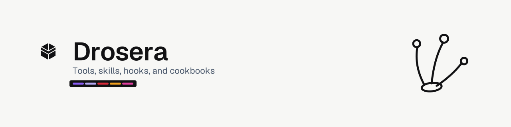

<picture>
  <source media="(prefers-color-scheme: dark)" srcset=".github/assets/drosera-banner-dark.svg">
  
</picture>

Tools, skills, hooks, and cookbooks

# drosera

Tooling for agents: tool faces, skills, hooks, cookbooks.

Drosera is the tooling system of Vivarium, the personal agent platform. It defines the four packaging forms an agent works with beyond its own context. Tool faces are neutral definitions of what can be called, following seed's tool-id grammar. Skills are packaged instructions that grow context without granting authority. Hooks are deterministic checks, fail closed, bound to run events. Cookbooks are recipes that compose published faces and skills, resolved at validation.

## The name

Drosera is the sundew. A sundew works by extension: sticky tentacles that reach out from the plant and hold what they touch, each one honest about what it has caught. That is the doctrine here: tools reach, each face says what it grips (summary, effect class), and the extensions never become the organism. The harness is the organism; drosera is what it holds.

## Status

Version 2.2.0. Pack formats, validation, reference resolution, the skill document reader, and the in-memory skill catalog are `implemented` in the reference library. A live registry, connector bindings, and server interfaces remain `specified` or `planned`.

## Install

```bash
npm install @vidoxlabs/drosera
```

Requires Node >= 22.13. Zero runtime dependencies.

## Modules

| Module | What it holds | Label |
| :--- | :--- | :--- |
| `pack.mjs` | Tool faces under seed's neutral tool-id grammar, and the tool pack that collects them with unique IDs and domain listings. | `implemented` |
| `skills.mjs` | Skill validation, lifecycle transitions, skill packs, and a catalog for promoted MIT skills. | `implemented` |
| `skill-markdown.mjs` | Reads a skill document's text, which the caller already holds, into the record `skills.mjs` checks. It opens no file. | `implemented` |
| `hooks.mjs` | Hook records: deterministic checks bound to run events, and the fail-closed hook pack. | `implemented` |
| `cookbook.mjs` | Recipes composing faces and skills, with validation that every reference resolves. | `implemented` |

## The family

Vivarium is the product. Its systems follow one naming law: ordinary botanical words that say what each system does ([the law](https://github.com/Vidoxlabs/capillary/blob/main/docs/family.md)).

| Name | Province |
| :--- | :--- |
| [`seed`](https://github.com/Vidoxlabs/seed) | Harness foundation: runs, tools, providers |
| [`capillary`](https://github.com/Vidoxlabs/capillary) | Context retrieval and relations, provenance-first |
| [`myosotis`](https://github.com/Vidoxlabs/myosotis) | Memory with consent and structural forget |
| [`aestivation`](https://github.com/Vidoxlabs/aestivation) | Plans, verdicts, and the gate before assembly |
| `drosera` (this repo) | Tool faces, skills, hooks, cookbooks |
| [`trellis`](https://github.com/Vidoxlabs/trellis) | Multi-point testing with dated evidence |
| [`bloom`](https://github.com/Vidoxlabs/bloom) | Vivarium's user interface: the app a person opens |
| [`vivarium`](https://github.com/Vidoxlabs/vivarium) | The product's umbrella: pins the seven systems at exact commits |
| [`docs`](https://github.com/Vidoxlabs/docs) | Family documentation, synced from every public repository |

## Documentation

- `AGENTS.md`: start here before editing. Stay in this repository's province.
- `docs/charter.md`: mission, principles, non-goals.
- `docs/architecture.md`: the tentacles and how they compose.
- `docs/contracts/`: the tool, skill, hook, and cookbook contracts.
- `docs/interop.md`: how each sibling meets this fabric.

## Development

```bash
npm test
```

Tests use the Node built-in runner. Adding a rule means adding the test that holds it.

## License

MIT

The Vidoxlabs name and mark are trademarks of Vidoxlabs LLC. They are not covered by this repository's MIT license.
